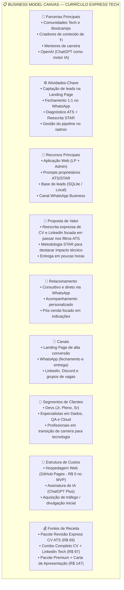
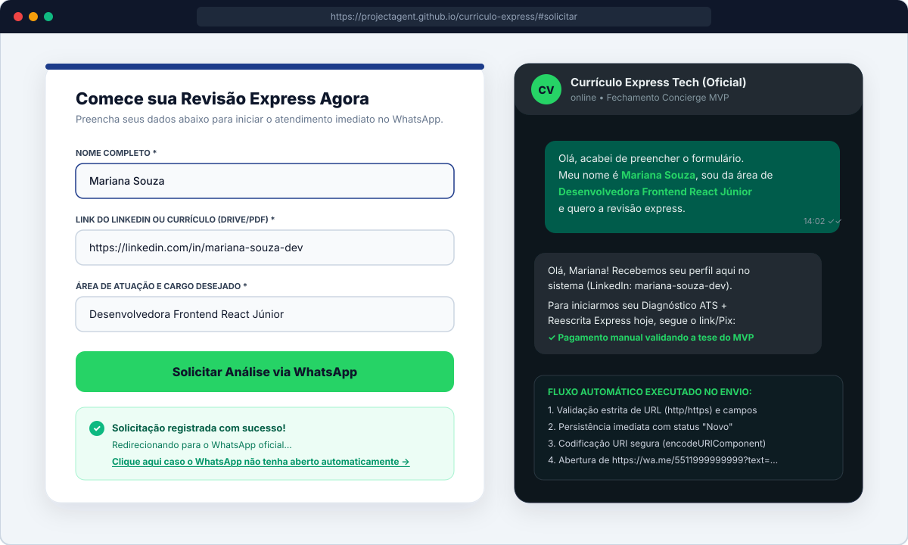
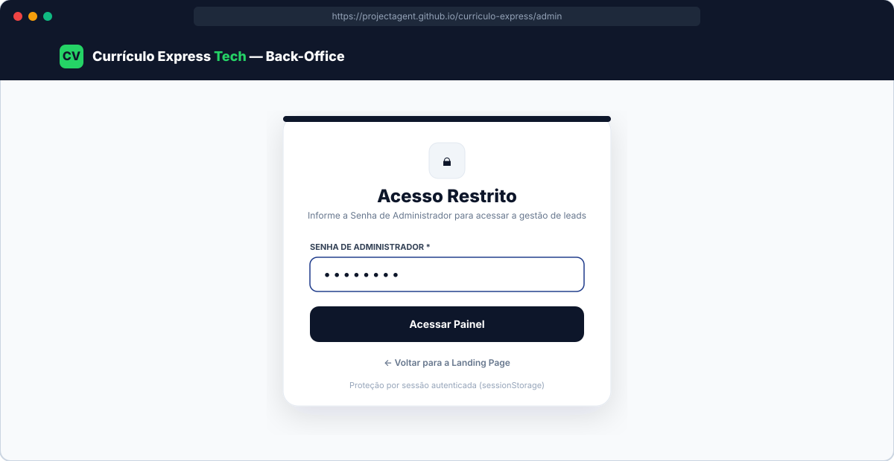
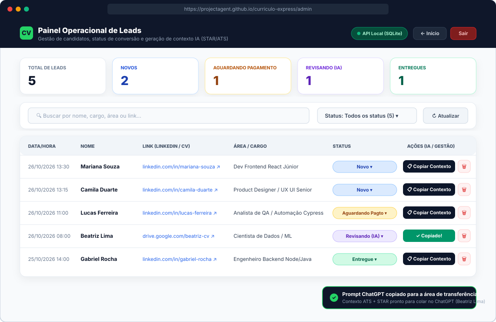

# 🚀 Currículo Express Tech — Da Ideia ao MVP com IA como Co-Founder

[](https://projectagent.github.io/curriculo-express/)
[](https://projectagent.github.io/curriculo-express/admin)
[](.github/workflows/deploy.yml)
[](TEST_READY.md)
[](tsconfig.json)
[](package.json)

> **Projeto de Entrega — Aceleração DIO: Tirando do Papel uma Ideia de Negócio até um Produto Digital no Ar**  
> Um MVP real construído para validar a tese de um serviço expresso de otimização de Currículo e LinkedIn focado em aprovar candidatos da área de tecnologia nos filtros de algoritmos **ATS (Applicant Tracking Systems)** e conquistar entrevistas.

---

## 🌐 1. Endereço da Aplicação Publicada

A aplicação está publicada, funcional e acessível publicamente via **GitHub Pages** (com persistência híbrida automática no navegador para demonstração interativa imediata e API Node.js + SQLite para operação local):

- 🔗 **Landing Page (Visão do Cliente):** [**https://projectagent.github.io/curriculo-express/**](https://projectagent.github.io/curriculo-express/)
- 🔐 **Painel de Administração (`/admin`):** [**https://projectagent.github.io/curriculo-express/admin**](https://projectagent.github.io/curriculo-express/admin) *(Credencial de demonstração do MVP: `admin123`)*
- 💻 **Repositório Oficial no GitHub:** [**https://github.com/projectagent/curriculo-express**](https://github.com/projectagent/curriculo-express)

---

## 🎯 2. A Dor Escolhida e Por Que Ela Vale um Negócio

### 2.1 Escolha da Dor (Matriz de Decisão com IA Co-Founder)
No início do processo de ideação com o ChatGPT atuando como *co-founder*, foram comparados dois problemas reais vividos no dia a dia de profissionais e estudantes de tecnologia:
1. **Ideia A — Organizador de Estudos e Trilhas Tech:** Dificuldade em organizar cursos, links e projetos de estudo. *(Descartada: dor latente/vitamina, baixa urgência financeira e alta competição com templates gratuitos do Notion).*
2. **Ideia B — Revisão Express de Currículo e LinkedIn para Filtros ATS (Escolhida ✅):** Profissionais qualificados de tecnologia (desenvolvedores, cientistas de dados, QAs, engenheiros cloud e pessoas em transição de carreira) enviam dezenas de currículos semanalmente e são **reprovados silenciosamente pelos robôs de triagem (ATS como Gupy, Greenhouse, Lever e Workday)** sem sequer chegar à leitura humana de um *tech recruiter*.

### 2.2 Por Que Essa Dor Vale um Negócio?
- **Dor Aguda ("Analgésico", não "Vitamina"):** Estar fora do mercado ou estagnado em um cargo abaixo do potencial custa milhares de reais por mês ao candidato. Pagar um valor acessível para destravar chamadas para entrevistas gera um **ROI imediato e óbvio** logo na primeira contratação.
- **Assimetria Técnica nos Algoritmos ATS:** Mais de 75% dos currículos são descartados na triagem automatizada não por falta de competência técnica do candidato, mas por ausência de palavras-chave exatas da vaga, formatação incompatível com *parsers* de PDF e descrições de experiência vagas (sem métricas de impacto no formato **STAR** — *Situação, Tarefa, Ação, Resultado*).
- **Escalabilidade e Margem com IA no Back-Office:** Combinando o atendimento consultivo no WhatsApp com engenharia de prompts estruturada no ChatGPT, o tempo de diagnóstico e reescrita cai de **3 horas para ~20 minutos por cliente**, permitindo entregar em poucas horas com margem bruta superior a **85%**.

---

## 📊 3. Tamanho de Mercado (TAM, SAM e SOM) e Business Model Canvas

### 3.1 Estimativa de Mercado (Brasil)

| Métrica | Definição no Contexto do Negócio | Estimativa Anual (BR) | Memória de Cálculo |
| :--- | :--- | :--- | :--- |
| **TAM** *(Total Addressable Market)* | Todo o mercado brasileiro de profissionais, formandos e estudantes de TI e áreas digitais que buscam emprego, recolocação ou promoção anualmente. | **R$ 145,5 milhões / ano** | ~1.500.000 candidatos tech ativos no Brasil × ticket médio de referência de **R$ 97,00** por otimização completa. |
| **SAM** *(Serviceable Available Market)* | Candidatos de tecnologia (Devs, Dados, QA, DevOps, Produto/UX) que aplicam ativamente pelo LinkedIn e plataformas ATS em língua portuguesa/inglesa. | **R$ 33,9 milhões / ano** | ~350.000 profissionais em busca ativa de vagas tech em processos seletivos competitivos × **R$ 97,00**. |
| **SOM** *(Serviceable Obtainable Market)* | Fatia realista capturável nos primeiros 12 meses de operação enxuta via comunidades tech, LinkedIn e indicação direta. | **R$ 139,6 mil / ano** | Meta operacional de **120 revisões/mês** (4 por dia × R$ 97,00 = R$ 11.640/mês), representando ~0,4% do SAM. |

---

### 3.2 Business Model Canvas (BMC)



---

## 🧪 4. A Tese que o MVP Testa e o Que Ficou Manual de Propósito

### 4.1 A Tese Central do MVP
> **"Candidatos da área de tecnologia que estão sendo barrados por filtros ATS estão dispostos a informar o link do seu perfil/currículo em um formulário rápido e fechar no WhatsApp a compra de uma reescrita expressa entregue em poucas horas."**

### 4.2 Hipóteses de Validação do MVP

| ID | Hipótese de Negócio | Como o MVP Mede | Critério de Sucesso (Meta) |
| :---: | :--- | :--- | :--- |
| **H1** | **Dor e Proposta de Valor:** A headline focada em *"passar nos filtros dos recrutadores"* converte visitantes em leads cadastrados. | Contagem de leads com status `Novo` registrados pelo formulário da Landing Page. | Taxa de conversão da LP **≥ 8%** dos visitantes únicos. |
| **H2** | **Baixa Fricção no Formulário:** Solicitar apenas 3 campos (*Nome*, *Link do LinkedIn/CV* e *Área/Cargo*) evita o abandono comum em formulários que exigem upload de arquivos pesados. | Taxa de conclusão do formulário (`LeadCaptureForm`) sem erros de submissão. | **≥ 70%** de conclusão entre usuários que iniciam o preenchimento. |
| **H3** | **Conversão Comercial via WhatsApp:** O redirecionamento imediato com mensagem personalizada leva o candidato a confirmar o pagamento. | Evolução do status no `/admin` de `Novo` ➔ `Aguardando Pagamento` ➔ `Revisando (IA)`. | **≥ 25%** dos leads `Novo` efetuam o pagamento via Pix/link no WhatsApp. |
| **H4** | **Velocidade Operacional com IA:** O botão *"Copiar Contexto"* do painel Admin permite gerar a reescrita ATS/STAR em poucos minutos. | Tempo entre o status `Revisando (IA)` e `Entregue` no painel administrativo. | Tempo médio operacional **< 25 minutos** por currículo revisado. |

### 4.3 O Que Ficou Manual de Propósito (*Concierge MVP*)
Seguindo a filosofia de validar primeiro antes de construir automações caras:

| Etapa do Fluxo | Como Funciona no MVP | Por Que Ficou Assim de Propósito? |
| :--- | :--- | :--- |
| **1. Captura e Qualificação** | **Automatizado na Aplicação:** Formulário valida nome, URL (`http/https`) e área/cargo, salva no banco e gera a URL `wa.me` codificada. | Garante que nenhum lead seja perdido mesmo se o usuário fechar a aba do WhatsApp. |
| **2. Fechamento e Pagamento** | **Manual no WhatsApp:** O especialista recebe a mensagem pré-preenchida do candidato, tira dúvidas e envia a chave Pix ou link de pagamento manualmente. | Permite conversar com os primeiros clientes reais, descobrir suas maiores objeções e testar diferentes faixas de preço sem gastar semanas integrando Stripe ou gateway bancário. |
| **3. Geração da Revisão ATS** | **Semi-automatizado (*Human-in-the-loop*):** No painel `/admin`, o operador clica em **"📋 Copiar Contexto"**, que gera o mega prompt personalizado do candidato, e cola no ChatGPT. | Evita custos fixos de API de LLM no início, elimina o risco de enviar textos alucinados diretamente ao cliente e garante curadoria humana de alta qualidade. |
| **4. Entrega do Material** | **Manual no WhatsApp + Status no Admin:** O especialista envia o PDF/Doc otimizado pelo WhatsApp e muda o status no painel para `Entregue`. | Cria um momento de entrega consultivo (*"Uau"*) que incentiva depoimentos e indicações orgânicas. |

---

## 🖼️ 5. Prints das Telas e do Painel em Funcionamento

### 5.1 Landing Page — Proposta de Valor e Como Funciona (3 Passos)
A página inicial comunica imediatamente a dor (filtros dos recrutadores/ATS), apresenta a promessa de transformação e explica o processo em 3 passos simples:


---

### 5.2 Formulário de Captura e Redirecionamento Automático para o WhatsApp
Ao preencher os 3 campos e clicar em **"Solicitar Análise via WhatsApp"**, a aplicação valida os dados, salva o lead como `Novo` e abre o WhatsApp com os dados do candidato já inseridos no corpo da mensagem:



---

### 5.3 Proteção de Acesso do Painel Administrativo (`/admin`)
Após os testes iniciais, a rota `/admin` recebeu um portão de autenticação por senha (`AdminLogin.tsx`) com sessão persistida em `sessionStorage`, impedindo acesso público indevido aos dados dos candidatos:



---

### 5.4 Painel de Administração (`/admin`) — Leads, Métricas, Status e Gerador de Contexto IA
O back-office exibe os **5 cards de métricas em tempo real**, barra de busca instantânea, filtro por status, tabela de candidatos, **dropdown interativo de 4 fases** (`Novo`, `Aguardando Pagamento`, `Revisando (IA)`, `Entregue`), botão **"📋 Copiar Contexto"** (que monta o prompt ATS/STAR para o ChatGPT) e exclusão com confirmação:



---

## 🤖 6. O Mega Prompt e as Correções Pedidas Depois

### 6.1 O Mega Prompt Inicial (Construção do MVP)
Abaixo está o **Mega Prompt** utilizado para estruturar o MVP com o fluxo completo do cliente (Landing Page + WhatsApp), o Painel de Administração (`/admin`), a camada de persistência inicial, a identidade visual e os critérios de aceitação:

```markdown
Construir o MVP de uma aplicação web de "Revisão Express de Currículo e LinkedIn" para candidatos da área de tecnologia, composta por Landing Page de alta conversão integrada ao WhatsApp e um Painel de Administração (/admin) para gestão de leads e aceleração do fluxo operacional manual.

Requirements

R1. Landing Page de Alta Conversão (Fluxo do Cliente)

Desenvolver uma Single Page Application responsiva (React + Tailwind CSS) focada em candidatos e estudantes de tecnologia. A página deve conter:

- Hero Section: Título de impacto ("Seu currículo não passa nos filtros dos recrutadores? Nós reescrevemos para você ser chamado para entrevistas") e subtítulo enfatizando a agilidade da entrega em poucas horas.
- Seção "Como Funciona": Explicação clara em 3 passos (1. Preencha o formulário, 2. Combine detalhes e pagamento no WhatsApp, 3. Receba seu perfil otimizado em poucas horas).
- Formulário de Captura: Campos para Nome Completo, Link do LinkedIn ou Currículo, Área de Atuação e Cargo Desejado, e botão de envio com chamada para ação ("Solicitar Análise via WhatsApp").
- Ação de Submissão: Ao enviar, o formulário deve salvar os dados do lead na tabela Leads e disparar o redirecionamento imediato para a URL do WhatsApp (https://wa.me/...) com mensagem pré-formatada: "Olá, acabei de preencher o formulário. Meu nome é [Nome], sou da área de [Área] e quero a revisão express." com codificação URI adequada.

R2. Painel de Administração e Gestão de Back-office (/admin)

Desenvolver uma visão administrativa para validação e operação do serviço:

- Rota acessível em /admin com listagem em tabela de todos os leads cadastrados.
- Colunas obrigatórias: Data/Hora do cadastro, Nome, Link (LinkedIn/CV), Área/Cargo e Status.
- Status Interativo: Dropdown por lead permitindo alternar e persistir o status entre: "Novo", "Aguardando Pagamento", "Revisando (IA)" e "Entregue".
- Ação "Copiar Contexto": Botão ao lado de cada registro que copia para o clipboard do sistema um texto padronizado pronto para ser colado no ChatGPT contendo Nome, Área/Cargo e Link do candidato.

R3. Persistência de Dados (Lovable Cloud / Backend)

- Implementar a camada de persistência para a tabela Leads utilizando a integração nativa com o backend Lovable Cloud (com fallback gracioso/mock estruturado documentado caso executado em ambiente offline de build).
- Suporte a operações de inserção (novo lead via formulário da LP), leitura (listagem no painel /admin) e atualização (mudança de status).

R4. Identidade Visual e Experiência do Usuário

- Paleta de cores: Azul Marinho (elementos primários de confiança), Branco (fundo limpo) e Verde WhatsApp (#25D366) para os botões de conversão e destaque.
- Tipografia moderna e legível (Inter ou Roboto).
- Design 100% responsivo para visualização fluida em dispositivos móveis e desktop.

Verification Resources

- Teste ponta a ponta simulando submissão de formulário e validação da URL gerada do WhatsApp com os parâmetros escapados.
- Teste de interface para a rota /admin verificando renderização da tabela, atualização de status e cópia para clipboard.
- Script de verificação de build sem erros de compilação ou linting (npm run build).

Acceptance Criteria

Landing Page & Conversão
- [x] O formulário valida os campos obrigatórios (Nome, Link, Área/Cargo) antes do envio.
- [x] Ao submeter o formulário, o lead é registrado e o navegador abre/redireciona para o link oficial do WhatsApp contendo o texto esperado com caracteres especiais devidamente codificados (encodeURIComponent).
- [x] A página é totalmente responsiva (mobile e desktop) com contraste acessível e identidade visual (Azul Marinho, Branco, Verde #25D366).

Painel Administrativo (/admin)
- [x] A rota /admin lista todos os leads cadastrados com data, nome, link, área/cargo e status atual.
- [x] Alterar o status no menu dropdown persiste a atualização do registro.
- [x] O botão "Copiar Contexto" copia para o clipboard uma string formatada com os dados do lead sem erros.

Engenharia & Build
- [x] O projeto compila com sucesso (npm run build ou equivalente) sem erros de TypeScript ou bundle.
```

---

### 6.2 Testes Como Cliente e os Prompts de Correção / Evolução

Após gerar a primeira versão e testar a aplicação como cliente real e como administrador do negócio, foram realizadas **3 rodadas de ajustes cirúrgicos** por meio dos prompts abaixo:

#### 🔧 Correção 1 — Usabilidade dos Inputs e Redirecionamento Único do WhatsApp
Ao testar o preenchimento do formulário na Landing Page, notou-se que o texto digitado nos inputs estava branco sobre fundo claro e que o envio abria o WhatsApp em duplicidade (navegando na aba atual e abrindo outra):

```markdown
Corrija os dois problemas de usabilidade abaixo no formulário da Landing Page:
1. Contraste da fonte nos inputs: O texto digitado está em branco. Ajuste as classes do Tailwind nos inputs para forçar uma cor de texto escura (text-gray-900).
2. Redirecionamento duplicado do WhatsApp: Ao submeter, a página navega e abre nova aba. Ajuste o submit para interceptar (e.preventDefault()), salvar os dados e abrir o link do WhatsApp estritamente em uma única nova aba (window.open).
```

---

#### 🔐 Correção 2 — Segurança do Back-Office (`/admin`) e Exclusão de Leads
Ao testar o painel de administração, identificou-se que a rota `/admin` estava aberta ao público e que faltava uma opção para excluir leads de teste ou cadastros duplicados:

```markdown
Implemente duas novas funcionalidades de segurança e gestão no Painel de Administração (/admin):

1. **Proteção de Acesso (Autenticação Simples):**
   - Bloqueie a renderização da rota `/admin`.
   - Ao acessar a URL, exiba primeiro uma tela de login simples solicitando uma "Senha de Administrador".
   - Configure a validação para uma senha estática (utilize uma variável de ambiente ou defina uma senha padrão no código, como "admin123", apenas para o escopo do MVP).
   - O dashboard e a tabela de leads só devem ficar visíveis e acessíveis se a senha inserida for correta.

2. **Exclusão de Leads (Delete):**
   - Adicione um botão de exclusão (ícone de lixeira em vermelho) na coluna de ações da tabela, ao lado do botão "Copiar Contexto".
   - Ao clicar no botão, acione um modal de confirmação (`window.confirm` ou um componente modal do Tailwind) perguntando: "Tem certeza que deseja excluir permanentemente este lead?".
   - Ao confirmar, execute a deleção do registro no backend do Lovable Cloud e atualize a tabela na interface imediatamente para refletir a remoção.
```

---

#### 🗄️ Correção 3 — Migração para Backend Local Node.js + SQLite (`/api`)
Por fim, para desacoplar o projeto do Lovable Cloud/Supabase e ter controle total da persistência em banco de dados relacional local (`leads.sqlite`) via API REST (mantendo fallback automático no navegador para a versão demonstrativa publicada no GitHub Pages):

```markdown
Refatore o projeto para remover a dependência do backend nativo do Lovable Cloud e migre a persistência de dados para um banco de dados relacional local rodando via API.

1. **Camada de Backend (Node.js + SQLite):**
   - Crie uma pasta `/api` na raiz do projeto.
   - Configure um servidor Node.js com `express` e `cors` rodando na porta 3001.
   - Utilize a biblioteca `sqlite3` para criar e conectar a um banco de dados local em arquivo (`leads.sqlite`).
   - Crie a tabela `leads` na inicialização do servidor com os campos: `id`, `nome`, `link`, `area`, `status`, e `data_criacao`.
   - Implemente as seguintes rotas REST:
     - `POST /leads`: Insere um novo lead.
     - `GET /leads`: Retorna todos os leads.
     - `PUT /leads/:id`: Atualiza o status de um lead específico.
     - `DELETE /leads/:id`: Remove um lead do banco.

2. **Camada de Frontend (React):**
   - Remova todas as importações, configurações e métodos relacionados ao Lovable Cloud/Supabase.
   - Substitua as operações de banco de dados nos componentes da Landing Page e do Painel Admin por requisições HTTP (`fetch` ou `axios`) apontando para `http://localhost:3001/leads`.
   - Garanta que a exclusão, atualização de status de funil e a submissão do formulário funcionem perfeitamente consumindo a nova API local.
   - Mantenha o design, a proteção da rota `/admin` e o redirecionamento do WhatsApp intactos.

3. **Configuração de Ambiente:**
   - Crie um arquivo `README_LOCAL.md` com os comandos necessários para instalar as dependências da `/api` e rodar o backend e o frontend simultaneamente.
```

---

## 🏗️ 7. Arquitetura Técnica em 4 Camadas

O código foi estruturado com separação limpa de responsabilidades (**Clean 4-Layer Architecture**):

```text
┌─────────────────────────────────────────────────────────────────────────────┐
│ 1. CAMADA DE APRESENTAÇÃO (UI / Components & Pages)                         │
│    LandingPage (/), AdminPage (/admin), NotFoundPage (*)                    │
│    HeroSection, HowItWorksSection, LeadCaptureForm, AdminLogin, LeadsTable  │
└──────────────────────────────────────┬──────────────────────────────────────┘
                                       │ Consome hooks reativos
┌──────────────────────────────────────▼──────────────────────────────────────┐
│ 2. CAMADA DE ESTADO E HOOKS (State & Interaction)                           │
│    useLeadForm, useLeads, useClipboard, useToast                            │
│    Validação em tempo real, UI otimista com rollback e feedback visual      │
└──────────────────────────────────────┬──────────────────────────────────────┘
                                       │ Orquestra serviços de domínio
┌──────────────────────────────────────▼──────────────────────────────────────┐
│ 3. CAMADA DE SERVIÇOS DE DOMÍNIO (Domain Services)                          │
│    whatsappService (sanitização de telefone e encodeURIComponent wa.me)     │
│    clipboardService (gerador de prompt ATS/STAR para ChatGPT)               │
│    leadService (cálculo de métricas em tempo real, filtros e ordenação)     │
└──────────────────────────────────────┬──────────────────────────────────────┘
                                       │ Persistência desacoplada
┌──────────────────────────────────────▼──────────────────────────────────────┐
│ 4. CAMADA DE DADOS E PERSISTÊNCIA HÍBRIDA (API REST + Storage Fallback)     │
│    src/services/api.ts (Cliente HTTP fetch com normalização bidirecional)   │
│    ├── Backend Local: Express + SQLite em modo WAL (/api ➔ leads.sqlite)    │
│    └── Fallback Estático/Offline: LocalStorageRepository + 5 Seed Leads     │
└─────────────────────────────────────────────────────────────────────────────┘
```

---

## 📂 8. Estrutura de Arquivos do Repositório

Todos os arquivos e diretórios abaixo existem no repositório e possuem implementação verificada:

```text
curriculo-express/
├── .github/
│   └── workflows/
│       └── deploy.yml                       # Pipeline CI/CD de build e publicação no GitHub Pages
├── api/
│   ├── db.js                                # Conexão singleton com SQLite (WAL mode) e criação da tabela leads
│   ├── routes/
│   │   └── leads.js                         # Endpoints REST: GET, POST, PUT e DELETE /leads
│   └── server.js                            # Servidor HTTP Express na porta 3001 com CORS e JSON
├── docs/
│   └── screenshots/
│       ├── landing-hero-steps.svg           # Tela da Landing Page (Hero + Como Funciona)
│       ├── landing-form-whatsapp.svg        # Tela do Formulário + Fluxo de mensagem no WhatsApp
│       ├── admin-login.svg                  # Tela de Acesso Restrito do Painel Admin (/admin)
│       └── admin-dashboard.svg              # Tela do Painel Admin com métricas, tabela e ações
├── public/
│   └── favicon.svg                          # Ícone vetorial da aplicação
├── src/
│   ├── main.tsx                             # Ponto de entrada React
│   ├── App.tsx                              # Roteamento SPA (/ e /admin) com basename dinâmico
│   ├── index.css                            # Estilos globais e tokens Tailwind CSS
│   ├── vite-env.d.ts                        # Tipagens de ambiente do Vite
│   ├── config/
│   │   ├── constants.ts                     # Textos da proposta de valor, passos e telefone padrão
│   │   └── env.ts                           # Leitura segura de variáveis de ambiente com fallbacks
│   ├── types/
│   │   ├── lead.ts                          # Contratos Lead, LeadStatus, CreateLeadDTO e LeadStats
│   │   └── common.ts                        # Tipos utilitários de validação
│   ├── utils/
│   │   ├── formatters.ts                    # Formatação de datas pt-BR e normalização de URLs
│   │   └── validators.ts                    # Validação de campos, protocolo HTTP/HTTPS e hostname
│   ├── services/
│   │   ├── api.ts                           # Cliente HTTP REST (/leads) com fallback automático
│   │   ├── leadService.ts                   # Cálculo de métricas, busca multi-campo e ordenação
│   │   ├── whatsappService.ts               # Geração de link wa.me com encodeURIComponent
│   │   ├── clipboardService.ts              # Construtor de prompt ATS/STAR para o ChatGPT
│   │   └── storage/
│   │       ├── ILeadsRepository.ts          # Contrato da camada de persistência
│   │       ├── LocalStorageRepository.ts    # Persistência no navegador com auto-recuperação de JSON
│   │       ├── seedData.ts                  # 5 leads iniciais para demonstração imediata do painel
│   │       └── storageFactory.ts            # Injeção de dependência do repositório de storage
│   ├── hooks/
│   │   ├── useLeadForm.ts                   # Ciclo de vida e envio do formulário de captura
│   │   ├── useLeads.ts                      # Listagem, filtro, mudança de status e exclusão de leads
│   │   ├── useClipboard.ts                  # Cópia para área de transferência com estado visual
│   │   └── useToast.ts                      # Sistema de notificações flutuantes (Toasts)
│   ├── components/
│   │   ├── common/
│   │   │   ├── Navbar.tsx                   # Cabeçalho com marca e atalho para /admin
│   │   │   ├── Footer.tsx                   # Rodapé institucional
│   │   │   ├── Button.tsx                   # Botão reutilizável com estados de loading
│   │   │   ├── StatusBadge.tsx              # Badge colorido por status do funil
│   │   │   ├── Toast.tsx                    # Componente visual de notificações
│   │   │   └── Icons.tsx                    # Biblioteca de ícones SVG leves e acessíveis
│   │   ├── landing/
│   │   │   ├── HeroSection.tsx              # Hero com headline de conversão e benefícios ATS
│   │   │   ├── HowItWorksSection.tsx        # Seção explicativa em 3 passos
│   │   │   ├── StepCard.tsx                 # Card individual de passo
│   │   │   ├── LeadCaptureForm.tsx          # Formulário validado com envio para o WhatsApp
│   │   │   └── TrustBadges.tsx              # Indicadores de segurança e agilidade
│   │   └── admin/
│   │       ├── AdminLogin.tsx               # Portão de autenticação por senha do /admin
│   │       ├── AdminHeader.tsx              # Cabeçalho do back-office com indicador de conexão e logout
│   │       ├── AdminStatsCards.tsx          # 5 cards de métricas do funil em tempo real
│   │       ├── TableFilters.tsx             # Busca instantânea e filtro por status
│   │       ├── LeadsTable.tsx               # Tabela responsiva de leads
│   │       ├── LeadTableRow.tsx             # Linha da tabela com ações integradas
│   │       ├── StatusDropdown.tsx           # Seletor interativo dos 4 status do funil
│   │       ├── CopyContextButton.tsx        # Botão que copia o prompt para o ChatGPT
│   │       ├── DeleteLeadButton.tsx         # Botão de exclusão com confirmação
│   │       └── EmptyState.tsx               # Estado vazio quando não há resultados
│   ├── pages/
│   │   ├── LandingPage.tsx                  # Página pública de captura (/)
│   │   ├── AdminPage.tsx                    # Página administrativa (/admin)
│   │   └── NotFoundPage.tsx                 # Página 404 amigável
│   ├── test/
│   │   └── setup.ts                         # Configuração global do ambiente de testes (Vitest + JSDOM)
│   └── __tests__/                           # Testes unitários e de componentes React
├── tests/
│   └── e2e/                                 # Suíte de testes de integração e E2E (Tiers 1 a 6)
├── .env.example                             # Modelo de variáveis de ambiente (sem chaves sensíveis)
├── .gitignore                               # Exclusão de node_modules, dist, .env e arquivos .sqlite
├── index.html                               # Template HTML principal
├── package.json                             # Scripts e dependências do projeto
├── postcss.config.js                        # Configuração PostCSS
├── tailwind.config.js                       # Tema e paleta de cores no Tailwind CSS
├── tsconfig.json                            # Configuração do compilador TypeScript
├── tsconfig.node.json                       # Configuração TypeScript para Node/Vite
├── vite.config.ts                           # Configuração do Vite e Vitest
├── README.md                                # Documentação principal de negócio e produto (este arquivo)
├── README_LOCAL.md                          # Guia detalhado para execução local (Frontend + API SQLite)
├── PROJECT.md                               # Especificação arquitetural e contratos da API
├── TEST_INFRA.md                            # Documentação da estratégia e infraestrutura de testes
└── TEST_READY.md                            # Relatório de cobertura e comandos da suíte de testes
```

---

## ⚙️ 9. Como Executar Localmente e Rodar os Testes

> 💡 Para um guia passo a passo completo focado em Windows PowerShell e na API SQLite, consulte também o arquivo [`README_LOCAL.md`](README_LOCAL.md).

### 9.1 Pré-requisitos e Variáveis de Ambiente
O projeto é **zero-config** por padrão (não exige nenhuma chave privada para rodar). Caso deseje personalizar o telefone de destino do WhatsApp ou a URL da API local, copie o arquivo [`.env.example`](.env.example) para `.env`:

```env
VITE_WHATSAPP_PHONE=5511999999999
VITE_API_BASE_URL=http://localhost:3001
```

### 9.2 Instalação e Execução Rápida
```powershell
# 1. Instalar dependências
npm.cmd install

# 2. (Opcional) Iniciar a API local Node.js + SQLite na porta 3001
npm.cmd run server

# 3. Iniciar o servidor de desenvolvimento Vite na porta 5173
npm.cmd run dev
```
- **Landing Page:** `http://localhost:5173/`
- **Painel Admin:** `http://localhost:5173/admin` *(Senha padrão: `admin123`)*

### 9.3 Executar Testes Automatizados e Build de Produção
```powershell
# Executar toda a suíte de testes automatizados (Unitários, Componentes, E2E e API SQLite)
npm.cmd test

# Compilar para produção (TypeScript + Vite Build)
npm.cmd run build
```

---

## 🚀 10. Próximos Passos (Roadmap Pós-Validação da Tese)

1. **Alerta de Novo Lead por E-mail (Resend):** Disparar notificação transacional sempre que um candidato preencher o formulário na Landing Page.
2. **Checkout Integrado (Stripe / Mercado Pago Pix):** Substituir o envio manual de chave Pix no WhatsApp por link de checkout direto após validar a taxa de conversão inicial.
3. **Automação no WhatsApp com n8n:** Conectar um webhook na rota `POST /leads` para enviar boas-vindas automáticas pelo WhatsApp e adiantar a coleta do PDF do currículo.
4. **Geração Automática de Diagnóstico em PDF:** Integrar a API da OpenAI no backend para já salvar um rascunho prévio da revisão ATS no painel `/admin` assim que o lead entra.

---

## 📄 Licença

Desenvolvido como projeto prático da **Aceleração DIO**. Distribuído sob a licença MIT.
