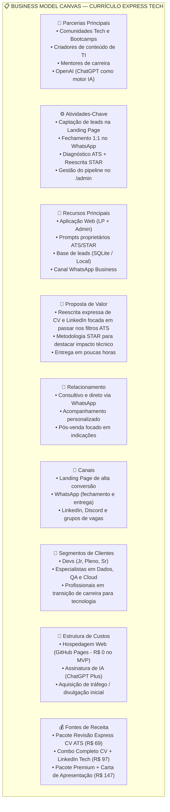

# 🚀 Currículo Express Tech — Da Ideia ao MVP com IA como Co-Founder

[](https://projectagent.github.io/curriculo-express/)
[](https://projectagent.github.io/curriculo-express/admin)
[](.github/workflows/deploy.yml)
[](TEST_READY.md)
[](tsconfig.json)
[](package.json)

> **Projeto de Entrega — Aceleração DIO: Tirando do Papel uma Ideia de Negócio até um Produto Digital no Ar**  
> Um MVP real construído para validar a tese de um serviço expresso de otimização de Currículo e LinkedIn focado em aprovar candidatos da área de tecnologia nos filtros de algoritmos **ATS (Applicant Tracking Systems)** e conquistar entrevistas.

---

## 🌐 1. Endereço da Aplicação Publicada

A aplicação está publicada, funcional e acessível publicamente via **GitHub Pages** (com persistência híbrida automática no navegador para demonstração interativa imediata e API Node.js + SQLite para operação local):

- 🔗 **Landing Page (Visão do Cliente):** [**https://projectagent.github.io/curriculo-express/**](https://projectagent.github.io/curriculo-express/)
- 🔐 **Painel de Administração (`/admin`):** [**https://projectagent.github.io/curriculo-express/admin**](https://projectagent.github.io/curriculo-express/admin) *(Credencial de demonstração do MVP: `admin123`)*
- 💻 **Repositório Oficial no GitHub:** [**https://github.com/projectagent/curriculo-express**](https://github.com/projectagent/curriculo-express)

---

## 🎯 2. A Dor Escolhida e Por Que Ela Vale um Negócio

### 2.1 Escolha da Dor (Matriz de Decisão com IA Co-Founder)
No início do processo de ideação com o ChatGPT atuando como *co-founder*, foram comparados dois problemas reais vividos no dia a dia de profissionais e estudantes de tecnologia:
1. **Ideia A — Organizador de Estudos e Trilhas Tech:** Dificuldade em organizar cursos, links e projetos de estudo. *(Descartada: dor latente/vitamina, baixa urgência financeira e alta competição com templates gratuitos do Notion).*
2. **Ideia B — Revisão Express de Currículo e LinkedIn para Filtros ATS (Escolhida ✅):** Profissionais qualificados de tecnologia (desenvolvedores, cientistas de dados, QAs, engenheiros cloud e pessoas em transição de carreira) enviam dezenas de currículos semanalmente e são **reprovados silenciosamente pelos robôs de triagem (ATS como Gupy, Greenhouse, Lever e Workday)** sem sequer chegar à leitura humana de um *tech recruiter*.

### 2.2 Por Que Essa Dor Vale um Negócio?
- **Dor Aguda ("Analgésico", não "Vitamina"):** Estar fora do mercado ou estagnado em um cargo abaixo do potencial custa milhares de reais por mês ao candidato. Pagar um valor acessível para destravar chamadas para entrevistas gera um **ROI imediato e óbvio** logo na primeira contratação.
- **Assimetria Técnica nos Algoritmos ATS:** Mais de 75% dos currículos são descartados na triagem automatizada não por falta de competência técnica do candidato, mas por ausência de palavras-chave exatas da vaga, formatação incompatível com *parsers* de PDF e descrições de experiência vagas (sem métricas de impacto no formato **STAR** — *Situação, Tarefa, Ação, Resultado*).
- **Escalabilidade e Margem com IA no Back-Office:** Combinando o atendimento consultivo no WhatsApp com engenharia de prompts estruturada no ChatGPT, o tempo de diagnóstico e reescrita cai de **3 horas para ~20 minutos por cliente**, permitindo entregar em poucas horas com margem bruta superior a **85%**.

---

## 📊 3. Tamanho de Mercado (TAM, SAM e SOM) e Business Model Canvas

### 3.1 Estimativa de Mercado (Brasil)

| Métrica | Definição no Contexto do Negócio | Estimativa Anual (BR) | Memória de Cálculo |
| :--- | :--- | :--- | :--- |
| **TAM** *(Total Addressable Market)* | Todo o mercado brasileiro de profissionais, formandos e estudantes de TI e áreas digitais que buscam emprego, recolocação ou promoção anualmente. | **R$ 145,5 milhões / ano** | ~1.500.000 candidatos tech ativos no Brasil × ticket médio de referência de **R$ 97,00** por otimização completa. |
| **SAM** *(Serviceable Available Market)* | Candidatos de tecnologia (Devs, Dados, QA, DevOps, Produto/UX) que aplicam ativamente pelo LinkedIn e plataformas ATS em língua portuguesa/inglesa. | **R$ 33,9 milhões / ano** | ~350.000 profissionais em busca ativa de vagas tech em processos seletivos competitivos × **R$ 97,00**. |
| **SOM** *(Serviceable Obtainable Market)* | Fatia realista capturável nos primeiros 12 meses de operação enxuta via comunidades tech, LinkedIn e indicação direta. | **R$ 139,6 mil / ano** | Meta operacional de **120 revisões/mês** (4 por dia × R$ 97,00 = R$ 11.640/mês), representando ~0,4% do SAM. |

---

### 3.2 Business Model Canvas (BMC)



---

## 🧪 4. A Tese que o MVP Testa e o Que Ficou Manual de Propósito

### 4.1 A Tese Central do MVP
> **"Candidatos da área de tecnologia que estão sendo barrados por filtros ATS estão dispostos a informar o link do seu perfil/currículo em um formulário rápido e fechar no WhatsApp a compra de uma reescrita expressa entregue em poucas horas."**

### 4.2 Hipóteses de Validação do MVP

| ID | Hipótese de Negócio | Como o MVP Mede | Critério de Sucesso (Meta) |
| :---: | :--- | :--- | :--- |
| **H1** | **Dor e Proposta de Valor:** A headline focada em *"passar nos filtros dos recrutadores"* converte visitantes em leads cadastrados. | Contagem de leads com status `Novo` registrados pelo formulário da Landing Page. | Taxa de conversão da LP **≥ 8%** dos visitantes únicos. |
| **H2** | **Baixa Fricção no Formulário:** Solicitar apenas 3 campos (*Nome*, *Link do LinkedIn/CV* e *Área/Cargo*) evita o abandono comum em formulários que exigem upload de arquivos pesados. | Taxa de conclusão do formulário (`LeadCaptureForm`) sem erros de submissão. | **≥ 70%** de conclusão entre usuários que iniciam o preenchimento. |
| **H3** | **Conversão Comercial via WhatsApp:** O redirecionamento imediato com mensagem personalizada leva o candidato a confirmar o pagamento. | Evolução do status no `/admin` de `Novo` ➔ `Aguardando Pagamento` ➔ `Revisando (IA)`. | **≥ 25%** dos leads `Novo` efetuam o pagamento via Pix/link no WhatsApp. |
| **H4** | **Velocidade Operacional com IA:** O botão *"Copiar Contexto"* do painel Admin permite gerar a reescrita ATS/STAR em poucos minutos. | Tempo entre o status `Revisando (IA)` e `Entregue` no painel administrativo. | Tempo médio operacional **< 25 minutos** por currículo revisado. |

### 4.3 O Que Ficou Manual de Propósito (*Concierge MVP*)
Seguindo a filosofia de validar primeiro antes de construir automações caras:

| Etapa do Fluxo | Como Funciona no MVP | Por Que Ficou Assim de Propósito? |
| :--- | :--- | :--- |
| **1. Captura e Qualificação** | **Automatizado na Aplicação:** Formulário valida nome, URL (`http/https`) e área/cargo, salva no banco e gera a URL `wa.me` codificada. | Garante que nenhum lead seja perdido mesmo se o usuário fechar a aba do WhatsApp. |
| **2. Fechamento e Pagamento** | **Manual no WhatsApp:** O especialista recebe a mensagem pré-preenchida do candidato, tira dúvidas e envia a chave Pix ou link de pagamento manualmente. | Permite conversar com os primeiros clientes reais, descobrir suas maiores objeções e testar diferentes faixas de preço sem gastar semanas integrando Stripe ou gateway bancário. |
| **3. Geração da Revisão ATS** | **Semi-automatizado (*Human-in-the-loop*):** No painel `/admin`, o operador clica em **"📋 Copiar Contexto"**, que gera o mega prompt personalizado do candidato, e cola no ChatGPT. | Evita custos fixos de API de LLM no início, elimina o risco de enviar textos alucinados diretamente ao cliente e garante curadoria humana de alta qualidade. |
| **4. Entrega do Material** | **Manual no WhatsApp + Status no Admin:** O especialista envia o PDF/Doc otimizado pelo WhatsApp e muda o status no painel para `Entregue`. | Cria um momento de entrega consultivo (*"Uau"*) que incentiva depoimentos e indicações orgânicas. |

---

## 🖼️ 5. Prints das Telas e do Painel em Funcionamento

### 5.1 Landing Page — Proposta de Valor e Como Funciona (3 Passos)
A página inicial comunica imediatamente a dor (filtros dos recrutadores/ATS), apresenta a promessa de transformação e explica o processo em 3 passos simples:


---

### 5.2 Formulário de Captura e Redirecionamento Automático para o WhatsApp
Ao preencher os 3 campos e clicar em **"Solicitar Análise via WhatsApp"**, a aplicação valida os dados, salva o lead como `Novo` e abre o WhatsApp com os dados do candidato já inseridos no corpo da mensagem:


---

### 5.3 Proteção de Acesso do Painel Administrativo (`/admin`)
Após os testes iniciais, a rota `/admin` recebeu um portão de autenticação por senha (`AdminLogin.tsx`) com sessão persistida em `sessionStorage`, impedindo acesso público indevido aos dados dos candidatos:


---

### 5.4 Painel de Administração (`/admin`) — Leads, Métricas, Status e Gerador de Contexto IA
O back-office exibe os **5 cards de métricas em tempo real**, barra de busca instantânea, filtro por status, tabela de candidatos, **dropdown interativo de 4 fases** (`Novo`, `Aguardando Pagamento`, `Revisando (IA)`, `Entregue`), botão **"📋 Copiar Contexto"** (que monta o prompt ATS/STAR para o ChatGPT) e exclusão com confirmação:


---

## 🤖 6. O Mega Prompt e as Correções Pedidas Depois

### 6.1 O Mega Prompt Inicial (Markdown)
Antes de gerar o código da aplicação, o prompt abaixo foi estruturado e refinado junto ao ChatGPT para especificar em uma única instrução o fluxo do cliente, o painel administrativo, o gerador de prompt interno e a identidade visual:

```markdown
# Mega Prompt — MVP: Revisão Express de Currículo e LinkedIn (Currículo Express Tech)

## 1. Contexto e Objetivo do Negócio
Construa uma aplicação web moderna e responsiva em React + TypeScript + Tailwind CSS para o MVP do negócio "Currículo Express Tech": um serviço expresso de diagnóstico e reescrita de Currículo e LinkedIn voltado para profissionais de tecnologia que querem passar nos filtros de algoritmos ATS (Applicant Tracking Systems) e ser chamados para entrevistas.

## 2. Identidade Visual e Paleta de Cores
- **Cor Primária (Confiança e Tecnologia):** Azul Marinho Profundo (`#0F172A` e `#1E3A8A`)
- **Cor de Fundo (Leitura Limpa):** Branco (`#FFFFFF`) e Cinza Gelo (`#F8FAFC`)
- **Cor de Destaque e Conversão (CTA):** Verde WhatsApp (`#25D366`)
- **Tipografia:** Sans-serif limpa (Inter), alto contraste e 100% responsiva (Mobile-First).

## 3. Fluxo do Cliente — Rota Principal (`/`)
1. **Hero Section:**
   - Headline exata: "Seu currículo não passa nos filtros dos recrutadores? Nós reescrevemos para você ser chamado para entrevistas"
   - Subtítulo destacando otimização focada em algoritmos ATS e recrutadores tech, com entrega em poucas horas.
   - Botão CTA principal rolando suavemente até o formulário.
2. **Seção Como Funciona (3 Passos):**
   - Passo 1: "Preencha o formulário" (Nome, link do currículo/LinkedIn e área de tecnologia desejada).
   - Passo 2: "Combine detalhes e pagamento no WhatsApp" (Alinhamento rápido e sem burocracia).
   - Passo 3: "Receba seu perfil otimizado em poucas horas" (Diagnóstico ATS + nova versão pronta para aplicar).
3. **Formulário de Captura Integrado ao WhatsApp:**
   - Campos obrigatórios com validação em tempo real:
     - `Nome Completo` (mínimo 3 caracteres)
     - `Link do LinkedIn ou Currículo (Drive/PDF)` (validação estrita de URL válida com http/https)
     - `Área de Atuação e Cargo Desejado` (ex: "Desenvolvedor Frontend React Júnior")
   - Botão de envio: "Solicitar Análise via WhatsApp".
   - Ao submeter:
     1. Salvar o lead na camada de dados com status inicial `"Novo"` e timestamp atual.
     2. Construir a URL do WhatsApp (`https://wa.me/5511999999999?text=...`) aplicando `encodeURIComponent` na mensagem exata:
        `"Olá, acabei de preencher o formulário. Meu nome é [Nome], sou da área de [Área] e quero a revisão express."`
     3. Abrir o WhatsApp em nova aba e exibir um banner de confirmação com link direto caso o bloqueador de pop-ups do navegador impeça a abertura automática.

## 4. Fluxo Operacional — Painel de Administração (`/admin`)
1. **Cards de Métricas no Topo:**
   - Contadores dinâmicos em tempo real para: `Total de Leads`, `Novos`, `Aguardando Pagamento`, `Revisando (IA)` e `Entregues`.
2. **Barra de Filtros:**
   - Busca textual instantânea (por nome, área/cargo ou link) e filtro por status.
3. **Tabela de Gestão de Leads:**
   - Colunas obrigatórias: `Data/Hora` (formato pt-BR `DD/MM/AAAA HH:mm`), `Nome`, `Link (LinkedIn / CV)` (clicável em nova aba), `Área / Cargo`, `Status` e `Ações`.
   - **Dropdown de Status Interativo por linha:** permite alternar e persistir imediatamente entre os 4 estados do funil:
     - `Novo` (badge azul)
     - `Aguardando Pagamento` (badge amarelo/âmbar)
     - `Revisando (IA)` (badge roxo)
     - `Entregue` (badge verde)
   - **Botão "Copiar Contexto" (Acelerador IA):**
     - Ao clicar, copia para a área de transferência um prompt estruturado pronto para colar no ChatGPT contendo os dados do lead (Nome, Área/Cargo e Link) e instruções para gerar Diagnóstico ATS, Reescrita com Metodologia STAR e Sugestão de Headline para LinkedIn.
```

---

### 6.2 Testes Como Cliente e o Prompt Único de Correções

Após gerar a primeira versão e testar a aplicação de ponta a ponta como cliente real e como administrador do negócio, foram identificados **3 pontos críticos de melhoria**:

1. **Falha de Segurança no Painel `/admin`:** Qualquer visitante que digitasse `/admin` na URL conseguia ver a lista de candidatos e alterar os status sem autenticação.
2. **Falta de Exclusão de Leads de Teste:** Quando preenchíamos o formulário para testar ou quando um lead enviava dados duplicados, não havia botão para remover o registro pelo painel.
3. **Persistência Híbrida (Banco de Dados Real + Funcionamento Estático no Deploy):** Era necessário desacoplar a persistência para contar tanto com um backend local dedicado em **Node.js + Express + SQLite (`leads.sqlite`)** quanto com um **fallback resiliente em `LocalStorage` pré-populado com *seed leads*** para que a demonstração publicada no GitHub Pages funcionasse 100% sem depender de servidor externo pago.

Abaixo está o **Prompt Único de Correções** elaborado para resolver esses pontos de uma só vez:

```markdown
# Prompt Único de Correções Pós-Teste (Modo Plan & Execução)

Após testar o fluxo completo como cliente e administrador, aplique as seguintes correções mantendo todas as funcionalidades existentes intactas:

1. **Proteção de Acesso na Rota `/admin` (`AdminLogin.tsx`):**
   - Bloqueie a visualização da tabela na rota `/admin` exigindo uma senha de administrador (padrão `admin123` ou via variável `VITE_ADMIN_PASSWORD`).
   - Persista o estado autenticado em `sessionStorage` e adicione um botão "Sair" no cabeçalho do painel administrativo (`AdminHeader.tsx`).

2. **Exclusão de Leads com Confirmação (`DeleteLeadButton.tsx`):**
   - Adicione um botão de exclusão (ícone de lixeira) na coluna de ações de cada lead no painel `/admin`.
   - Exiba uma confirmação de segurança (`"Tem certeza que deseja excluir permanentemente este lead?"`) antes de remover o registro e atualizar as métricas imediatamente.

3. **Persistência Híbrida Desacoplada (API SQLite + Fallback LocalStorage):**
   - Crie uma API REST modular em `/api` (`api/db.js`, `api/routes/leads.js`, `api/server.js`) usando Node.js, Express e SQLite (`leads.sqlite` em modo WAL) na porta 3001 com as rotas `GET /leads`, `POST /leads`, `PUT /leads/:id` e `DELETE /leads/:id`.
   - No frontend (`src/services/api.ts`), conecte os hooks à API REST e mantenha fallback transparente para `LocalStorageRepository` (com 5 leads iniciais em `seedData.ts`) quando a aplicação rodar em ambiente estático/offline (GitHub Pages).
   - No workflow de deploy para o GitHub Pages (`.github/workflows/deploy.yml`), gere a cópia `dist/404.html` e configure `basename={import.meta.env.BASE_URL}` no `BrowserRouter` para que o acesso direto à URL `/admin` não retorne erro 404.
```

---

## 🏗️ 7. Arquitetura Técnica em 4 Camadas

O código foi estruturado com separação limpa de responsabilidades (**Clean 4-Layer Architecture**):

```text
┌─────────────────────────────────────────────────────────────────────────────┐
│ 1. CAMADA DE APRESENTAÇÃO (UI / Components & Pages)                         │
│    LandingPage (/), AdminPage (/admin), NotFoundPage (*)                    │
│    HeroSection, HowItWorksSection, LeadCaptureForm, AdminLogin, LeadsTable  │
└──────────────────────────────────────┬──────────────────────────────────────┘
                                       │ Consome hooks reativos
┌──────────────────────────────────────▼──────────────────────────────────────┐
│ 2. CAMADA DE ESTADO E HOOKS (State & Interaction)                           │
│    useLeadForm, useLeads, useClipboard, useToast                            │
│    Validação em tempo real, UI otimista com rollback e feedback visual      │
└──────────────────────────────────────┬──────────────────────────────────────┘
                                       │ Orquestra serviços de domínio
┌──────────────────────────────────────▼──────────────────────────────────────┐
│ 3. CAMADA DE SERVIÇOS DE DOMÍNIO (Domain Services)                          │
│    whatsappService (sanitização de telefone e encodeURIComponent wa.me)     │
│    clipboardService (gerador de prompt ATS/STAR para ChatGPT)               │
│    leadService (cálculo de métricas em tempo real, filtros e ordenação)     │
└──────────────────────────────────────┬──────────────────────────────────────┘
                                       │ Persistência desacoplada
┌──────────────────────────────────────▼──────────────────────────────────────┐
│ 4. CAMADA DE DADOS E PERSISTÊNCIA HÍBRIDA (API REST + Storage Fallback)     │
│    src/services/api.ts (Cliente HTTP fetch com normalização bidirecional)   │
│    ├── Backend Local: Express + SQLite em modo WAL (/api ➔ leads.sqlite)    │
│    └── Fallback Estático/Offline: LocalStorageRepository + 5 Seed Leads     │
└─────────────────────────────────────────────────────────────────────────────┘
```

---

## 📂 8. Estrutura de Arquivos do Repositório

Todos os arquivos e diretórios abaixo existem no repositório e possuem implementação verificada:

```text
curriculo-express/
├── .github/
│   └── workflows/
│       └── deploy.yml                       # Pipeline CI/CD de build e publicação no GitHub Pages
├── api/
│   ├── db.js                                # Conexão singleton com SQLite (WAL mode) e criação da tabela leads
│   ├── routes/
│   │   └── leads.js                         # Endpoints REST: GET, POST, PUT e DELETE /leads
│   └── server.js                            # Servidor HTTP Express na porta 3001 com CORS e JSON
├── docs/
│   └── screenshots/
│       ├── landing-hero-steps.svg           # Tela da Landing Page (Hero + Como Funciona)
│       ├── landing-form-whatsapp.svg        # Tela do Formulário + Fluxo de mensagem no WhatsApp
│       ├── admin-login.svg                  # Tela de Acesso Restrito do Painel Admin (/admin)
│       └── admin-dashboard.svg              # Tela do Painel Admin com métricas, tabela e ações
├── public/
│   └── favicon.svg                          # Ícone vetorial da aplicação
├── src/
│   ├── main.tsx                             # Ponto de entrada React
│   ├── App.tsx                              # Roteamento SPA (/ e /admin) com basename dinâmico
│   ├── index.css                            # Estilos globais e tokens Tailwind CSS
│   ├── vite-env.d.ts                        # Tipagens de ambiente do Vite
│   ├── config/
│   │   ├── constants.ts                     # Textos da proposta de valor, passos e telefone padrão
│   │   └── env.ts                           # Leitura segura de variáveis de ambiente com fallbacks
│   ├── types/
│   │   ├── lead.ts                          # Contratos Lead, LeadStatus, CreateLeadDTO e LeadStats
│   │   └── common.ts                        # Tipos utilitários de validação
│   ├── utils/
│   │   ├── formatters.ts                    # Formatação de datas pt-BR e normalização de URLs
│   │   └── validators.ts                    # Validação de campos, protocolo HTTP/HTTPS e hostname
│   ├── services/
│   │   ├── api.ts                           # Cliente HTTP REST (/leads) com fallback automático
│   │   ├── leadService.ts                   # Cálculo de métricas, busca multi-campo e ordenação
│   │   ├── whatsappService.ts               # Geração de link wa.me com encodeURIComponent
│   │   ├── clipboardService.ts              # Construtor de prompt ATS/STAR para o ChatGPT
│   │   └── storage/
│   │       ├── ILeadsRepository.ts          # Contrato da camada de persistência
│   │       ├── LocalStorageRepository.ts    # Persistência no navegador com auto-recuperação de JSON
│   │       ├── seedData.ts                  # 5 leads iniciais para demonstração imediata do painel
│   │       └── storageFactory.ts            # Injeção de dependência do repositório de storage
│   ├── hooks/
│   │   ├── useLeadForm.ts                   # Ciclo de vida e envio do formulário de captura
│   │   ├── useLeads.ts                      # Listagem, filtro, mudança de status e exclusão de leads
│   │   ├── useClipboard.ts                  # Cópia para área de transferência com estado visual
│   │   └── useToast.ts                      # Sistema de notificações flutuantes (Toasts)
│   ├── components/
│   │   ├── common/
│   │   │   ├── Navbar.tsx                   # Cabeçalho com marca e atalho para /admin
│   │   │   ├── Footer.tsx                   # Rodapé institucional
│   │   │   ├── Button.tsx                   # Botão reutilizável com estados de loading
│   │   │   ├── StatusBadge.tsx              # Badge colorido por status do funil
│   │   │   ├── Toast.tsx                    # Componente visual de notificações
│   │   │   └── Icons.tsx                    # Biblioteca de ícones SVG leves e acessíveis
│   │   ├── landing/
│   │   │   ├── HeroSection.tsx              # Hero com headline de conversão e benefícios ATS
│   │   │   ├── HowItWorksSection.tsx        # Seção explicativa em 3 passos
│   │   │   ├── StepCard.tsx                 # Card individual de passo
│   │   │   ├── LeadCaptureForm.tsx          # Formulário validado com envio para o WhatsApp
│   │   │   └── TrustBadges.tsx              # Indicadores de segurança e agilidade
│   │   └── admin/
│   │       ├── AdminLogin.tsx               # Portão de autenticação por senha do /admin
│   │       ├── AdminHeader.tsx              # Cabeçalho do back-office com indicador de conexão e logout
│   │       ├── AdminStatsCards.tsx          # 5 cards de métricas do funil em tempo real
│   │       ├── TableFilters.tsx             # Busca instantânea e filtro por status
│   │       ├── LeadsTable.tsx               # Tabela responsiva de leads
│   │       ├── LeadTableRow.tsx             # Linha da tabela com ações integradas
│   │       ├── StatusDropdown.tsx           # Seletor interativo dos 4 status do funil
│   │       ├── CopyContextButton.tsx        # Botão que copia o prompt para o ChatGPT
│   │       ├── DeleteLeadButton.tsx         # Botão de exclusão com confirmação
│   │       └── EmptyState.tsx               # Estado vazio quando não há resultados
│   ├── pages/
│   │   ├── LandingPage.tsx                  # Página pública de captura (/)
│   │   ├── AdminPage.tsx                    # Página administrativa (/admin)
│   │   └── NotFoundPage.tsx                 # Página 404 amigável
│   ├── test/
│   │   └── setup.ts                         # Configuração global do ambiente de testes (Vitest + JSDOM)
│   └── __tests__/                           # Testes unitários e de componentes React
├── tests/
│   └── e2e/                                 # Suíte de testes de integração e E2E (Tiers 1 a 6)
├── .env.example                             # Modelo de variáveis de ambiente (sem chaves sensíveis)
├── .gitignore                               # Exclusão de node_modules, dist, .env e arquivos .sqlite
├── index.html                               # Template HTML principal
├── package.json                             # Scripts e dependências do projeto
├── postcss.config.js                        # Configuração PostCSS
├── tailwind.config.js                       # Tema e paleta de cores no Tailwind CSS
├── tsconfig.json                            # Configuração do compilador TypeScript
├── tsconfig.node.json                       # Configuração TypeScript para Node/Vite
├── vite.config.ts                           # Configuração do Vite e Vitest
├── README.md                                # Documentação principal de negócio e produto (este arquivo)
├── README_LOCAL.md                          # Guia detalhado para execução local (Frontend + API SQLite)
├── PROJECT.md                               # Especificação arquitetural e contratos da API
├── TEST_INFRA.md                            # Documentação da estratégia e infraestrutura de testes
└── TEST_READY.md                            # Relatório de cobertura e comandos da suíte de testes
```

---

## ⚙️ 9. Como Executar Localmente e Rodar os Testes

> 💡 Para um guia passo a passo completo focado em Windows PowerShell e na API SQLite, consulte também o arquivo [`README_LOCAL.md`](README_LOCAL.md).

### 9.1 Pré-requisitos e Variáveis de Ambiente
O projeto é **zero-config** por padrão (não exige nenhuma chave privada para rodar). Caso deseje personalizar o telefone de destino do WhatsApp ou a URL da API local, copie o arquivo [`.env.example`](.env.example) para `.env`:

```env
VITE_WHATSAPP_PHONE=5511999999999
VITE_API_BASE_URL=http://localhost:3001
```

### 9.2 Instalação e Execução Rápida
```powershell
# 1. Instalar dependências
npm.cmd install

# 2. (Opcional) Iniciar a API local Node.js + SQLite na porta 3001
npm.cmd run server

# 3. Iniciar o servidor de desenvolvimento Vite na porta 5173
npm.cmd run dev
```
- **Landing Page:** `http://localhost:5173/`
- **Painel Admin:** `http://localhost:5173/admin` *(Senha padrão: `admin123`)*

### 9.3 Executar Testes Automatizados e Build de Produção
```powershell
# Executar toda a suíte de testes automatizados (Unitários, Componentes, E2E e API SQLite)
npm.cmd test

# Compilar para produção (TypeScript + Vite Build)
npm.cmd run build
```

---

## 🚀 10. Próximos Passos (Roadmap Pós-Validação da Tese)

1. **Alerta de Novo Lead por E-mail (Resend):** Disparar notificação transacional sempre que um candidato preencher o formulário na Landing Page.
2. **Checkout Integrado (Stripe / Mercado Pago Pix):** Substituir o envio manual de chave Pix no WhatsApp por link de checkout direto após validar a taxa de conversão inicial.
3. **Automação no WhatsApp com n8n:** Conectar um webhook na rota `POST /leads` para enviar boas-vindas automáticas pelo WhatsApp e adiantar a coleta do PDF do currículo.
4. **Geração Automática de Diagnóstico em PDF:** Integrar a API da OpenAI no backend para já salvar um rascunho prévio da revisão ATS no painel `/admin` assim que o lead entra.

---

## 📄 Licença

Desenvolvido como projeto prático da **Aceleração DIO**. Distribuído sob a licença MIT.
